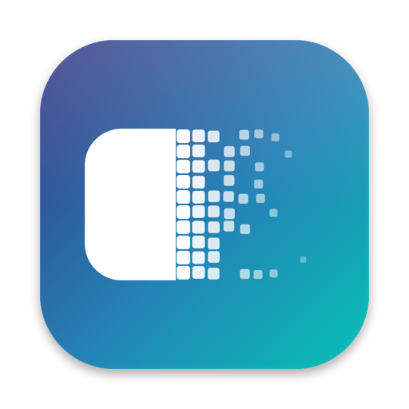

<p align="center"></p>

# SinRastro

Desinstalador nativo para macOS. Lista tus apps, muestra sus procesos y archivos residuales, y los quita solo después de que confirmes. Lo desinstalado se guarda 7 días en una cuarentena desde la que puedes restaurarlo.

Hecho en SwiftUI, para macOS 15 o posterior. Interfaz en español.

Página del proyecto: https://davidmenendez9901.github.io/SinRastro/

> **Estado: experimental.** La parte que actúa como administrador (borrar en `/Library`, restaurar y vaciar como root) está cubierta por tests, pero aún no se ha ejecutado con privilegios reales. Úsala bajo tu responsabilidad y revisa siempre la lista antes de confirmar.

## Qué hace

- **Escanea una app:** busca en `~/Library` y `/Library` (Application Support, Caches, Logs, Preferences, Containers, LaunchAgents, LaunchDaemons y otras) lo que pertenece a la app.
- **Empareja con cuidado:** por bundle id con frontera de punto (`com.foo.app` no arrastra a `com.foo.app2`), por plists de launchd que apuntan a la app, por recibos de `pkgutil` y por los group containers que nombra su entitlement.
- **Carpetas de fabricante:** encuentra `Application Support/Google/AndroidStudio2026.1` y similares.
- **Coincidencias dudosas sin marcar:** lo que solo coincide por nombre sale desmarcado.
- **Cierra la app antes de borrar:** descarga sus agentes de launchd y termina sus procesos.
- **Tres formas de quitar:** cuarentena (por defecto, restaurable), Papelera, o borrado definitivo.
- **Registro:** cada desinstalación se anota en `~/Library/Logs/SinRastro/uninstall.log`.

## Seguridad

- **Una sola política de rutas** (`Shared/PathPolicy.swift`) decide qué se puede tocar. La usan el escaneo, la desinstalación y el helper root, y se vuelve a aplicar justo antes de borrar.
- **Nunca se tocan** `/System`, `/usr`, `/bin`, `/sbin`, `/opt`, `/private`, las raíces de `/Applications`, `/Library` o el home, ni nada protegido por SIP.
- **Sin daemon permanente.** Lo que necesita administrador pasa por un helper que se ejecuta una vez; macOS pide la contraseña.
- **El helper no confía en lo que le pide la app:** lee la identidad del propio bundle, revalida cada ruta y borra sin seguir enlaces simbólicos (`Shared/SafeFS.swift`).

## Limitaciones conocidas

- No limpia permisos de privacidad (TCC), system extensions ni `/private/var/folders`.
- No busca restos de apps que ya no están instaladas.
- En cuarentena no se olvidan los recibos de `pkgutil`; solo en el borrado definitivo.
- Los agentes y daemons restaurados no se recargan hasta volver a iniciar sesión.
- La compilación va con firma ad hoc: Gatekeeper avisará en otros Macs, y el helper dentro del bundle no está protegido frente a otro proceso de tu mismo usuario. Para distribuirla en serio hace falta Developer ID y notarización.
- Sin Acceso total al disco el escaneo queda incompleto; la app lo indica.

## Compilar

Necesitas Xcode 16 o posterior.

```bash
xcodebuild -project SinRastro.xcodeproj -scheme SinRastro -configuration Release -derivedDataPath build build
```

La app queda en `build/Build/Products/Release/SinRastro.app`. Para empaquetarla en un DMG:

```bash
Tools/make-dmg.sh
```

## Tests

```bash
xcodebuild -project SinRastro.xcodeproj -scheme SinRastro -derivedDataPath build test
```

Los tests montan un sistema de archivos falso en un directorio temporal; nunca tocan tu `/Applications` ni tu home.

## Estructura

| Carpeta | Contenido |
| --- | --- |
| `Shared/` | Política de rutas, emparejador, borrado seguro y lógica del helper. La compilan la app y el helper. |
| `Core/` | Catálogo de apps, escaneo, desinstalación y cuarentena. |
| `SinRastro/` | Interfaz SwiftUI. |
| `PrivilegedHelper/` | Punto de entrada del helper root. |
| `SinRastroTests/` | Tests con Swift Testing. |
| `Tools/` | Scripts para generar el icono y el DMG. |

## Licencia

[MIT](LICENSE).
